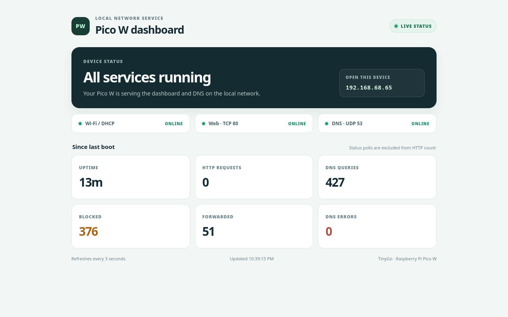

# Pico W web server and DNS filter with TinyGo

Join an existing Wi-Fi network, get an IPv4 address using DHCP, and serve
`index.html` directly from the Pico W's flash on HTTP port 80. No extra hardware
is needed beyond a Pico W, USB data cable, and a router. The project also has an
early DNS-filter port based on [ESP_hole](https://github.com/twedds95/ESP_hole).

## Project layout

Firmware source and embedded assets stay at the repository root for TinyGo.
User guides live in `docs/`, benchmark tools and result data in `benchmarks/`,
maintenance scripts in `tools/`, and Python/device integration tests in
`tests/`. Go unit tests remain alongside the firmware package.

## Configure

Use a **2.4 GHz Wi-Fi network**, normally WPA2 Personal. The Pico W cannot
join a 5 GHz-only network. Your computer can use Ethernet or another Wi-Fi band
as long as both devices can communicate on the same LAN.

Edit `secrets.go` and set:

```go
const wifiSSID = "Your Wi-Fi name"
const wifiPassword = "Your Wi-Fi password"
```

An empty password selects an open network. `secrets.go` is ignored by Git.
On a fresh checkout, first run `cp secrets.go.example secrets.go`.
Credentials are embedded in the firmware; keep the source and UF2 file private.
You do not need to share the password in chat.

Edit `index.html` to change the page. CSS and JavaScript can be inline, so the
page works entirely on your LAN without a CDN or internet access. Only `/` and
`/index.html` serve the page; separate asset files are not served by this starter.

## Dashboard



This is a point-in-time screenshot; the dashboard shows live values when served
by the Pico.

## Build and flash

Verified with **TinyGo 0.42.0 and Go 1.26.1**, targeting the original RP2040 Pico W.
Install Go and TinyGo following [TinyGo's installation guide](https://tinygo.org/getting-started/install/).
The Wi-Fi driver and network stack versions are pinned in `go.mod`/`go.sum`.

From this directory:

```sh
go mod download
mkdir -p build
tinygo build -target=pico-w -scheduler=tasks -stack-size=8kb -o build/pico-webserver.uf2 .
```

Or simply use `make build`.
**Keep `-scheduler=tasks`: the Wi-Fi helper does not support the default cores scheduler.**

1. Hold **BOOTSEL** while plugging the Pico W into your computer with a USB data cable.
2. Release BOOTSEL when the `RPI-RP2` drive appears.
3. Copy `build/pico-webserver.uf2` to that drive. The Pico reboots and runs the server.

Alternatively, with the Pico in BOOTSEL mode:

```sh
tinygo flash -target=pico-w -scheduler=tasks -stack-size=8kb -monitor .
```

That flashes the board and opens the USB serial monitor. `make flash` does the
same. Subsequent flashes may also require BOOTSEL.

**Build after editing `secrets.go` before flashing.** Rebuild and reflash after
HTML edits too.

For this Codex session, TinyGo and a compatible Go toolchain were downloaded to
`/tmp` without a system-wide installation. You can use them now by running the
following in your terminal before `make build` or `make flash`:

```sh
export GOROOT=/tmp/pico-go/pkg/mod/golang.org/toolchain@v0.0.1-go1.26.1.linux-amd64
export PATH="/tmp/tinygo/bin:$GOROOT/bin:$PATH"
export GOPATH=/tmp/pico-go
export GOCACHE=/tmp/pico-gocache
export XDG_CACHE_HOME=/tmp/pico-cache
```

These temporary tools may be removed on reboot; install TinyGo normally for
ongoing use.

## Visit the page

The USB serial output prints its address at startup and when a serial monitor
connects, so you can retrieve it even after startup. It looks like:

```text
Open this address on another machine on your LAN:
http://192.168.1.123/
```

Visit the address actually printed by your Pico, using **http://**. You can also
find its IP in the router's DHCP client list; the requested hostname is
`pico-webserver`. This does not automatically create a `pico-webserver.local`
address. A DHCP reservation in your router can keep the IP consistent.

For serial output after copying the UF2, open the Pico's USB serial port in a
terminal such as `screen /dev/ttyACM0 115200` on Linux (use the actual device
path). Connecting the monitor prints the current address; a reset is not needed.

On this Linux machine, if opening the serial port gives "permission denied", run:

```sh
sudo setfacl -m u:yuhuishi:rw /dev/ttyACM0
```

This grants this user access to the current serial device. Unplugging or
reflashing recreates the device and clears that temporary grant.

## Behavior and troubleshooting

- Up to three connections are handled concurrently, with one request per connection.
- GET and HEAD work for the page, query strings are accepted, and other paths return 404.
- Request headers are limited to 2 KiB; each request has a five-second deadline.
- The helper only acquires the initial DHCP lease. This starter reboots halfway
  through the lease, or after 12 hours, whichever is earlier, to obtain a fresh
  lease. Expect a brief interruption and possibly a different IP. This is a small
  hobby server, rather than an uninterrupted hosting service.
- If Wi-Fi setup or DHCP fails, the serial output shows the error. Check the SSID,
  password, 2.4 GHz availability, and DHCP, then power-cycle the board. If Wi-Fi
  drops later, power-cycle to reconnect promptly.
- If the Pico has an IP but another machine cannot reach it, check guest-network
  isolation, AP/client isolation, and whether the devices are on different VLANs.

## Validation

```sh
go test ./...
```

Host tests exercise fragmented requests and partial writes, GET/HEAD, query
strings, 404/405/204 responses, malformed and oversized headers, and incomplete
requests. The DNS policy and request/response tests pass, and the firmware builds
for `pico-w`. The dashboard is flashed and responds at `http://192.168.68.65/`.
A disposable Podman client configured with `--dns=192.168.68.65` successfully
resolved `example.com` over both A and AAAA. The host DNS settings were not
changed. DHCP may assign a different Pico address later.

## DNS filter port

Port 80 serves a responsive dashboard and a JSON status endpoint at `/api/status`.
It shows Wi-Fi/DHCP, HTTP and DNS listener state, uptime, HTTP requests, DNS
queries, blocked and forwarded counts, and DNS errors. The firmware listens on
UDP port 53 and includes Pi-hole's commonly installed StevenBlack Unified
hosts list (72,233 domains in the checked-in snapshot). Add local exceptions in
`allowedDomains` or extra entries in `blockedDomains` in `dns_policy.go`. Rules
match the domain and its subdomains, case-insensitively; allow entries override
the built-in and custom block rules. Blocked A/AAAA lookups return
`0.0.0.0`/`::`. See the [user guide](docs/USER_GUIDE.md) for updating the
built-in list and local rules, and [BLOCKLIST.md](docs/BLOCKLIST.md) for the
source, memory use, matcher, and validation details.

This initial version handles one DNS question at a time and resolves upstream
queries serially. Use it as a small LAN filter, not as a high-throughput DNS
service. It does not configure your router or other clients automatically.
Run `./tests/integration/test-dns-podman.sh 192.168.68.65` to test A and AAAA lookups from a
disposable Podman client. The script sets DNS only inside that container, so the
computer running Podman keeps its existing DNS configuration. After adding and
flashing rules, pass a blocked name and an allowed exception to also check the
sink response and the allowlist override:

```sh
./tests/integration/test-dns-podman.sh 192.168.68.65 img.ads.example safe.ads.example
```

Host tests cover the compiled common list, case-insensitive suffix matching,
subdomain boundaries, allowlist precedence, blocked sink answers, and that
blocked requests never reach the upstream resolver.

The pinned `lneto` TCP stack requires `NewBackoff` in `TCPPoolConfig`.
Keep the explicit `tcpBackoff` function when changing the networking setup.

## Benchmark

For measured HTTP and DNS performance, host-side matcher timings, and
repeatable benchmark commands, see [BENCHMARK.md](docs/BENCHMARK.md).

## Source references

- [TinyGo Pico W documentation](https://tinygo.org/docs/reference/microcontrollers/featured/pico-w/)
- [CYW43439 driver](https://github.com/soypat/cyw43439)
- [Pinned driver's HTTP server example](https://github.com/soypat/cyw43439/blob/56295b807581/examples/http-server/main.go)
- [Raspberry Pi Pico W datasheet](https://datasheets.raspberrypi.com/picow/pico-w-datasheet.pdf)
